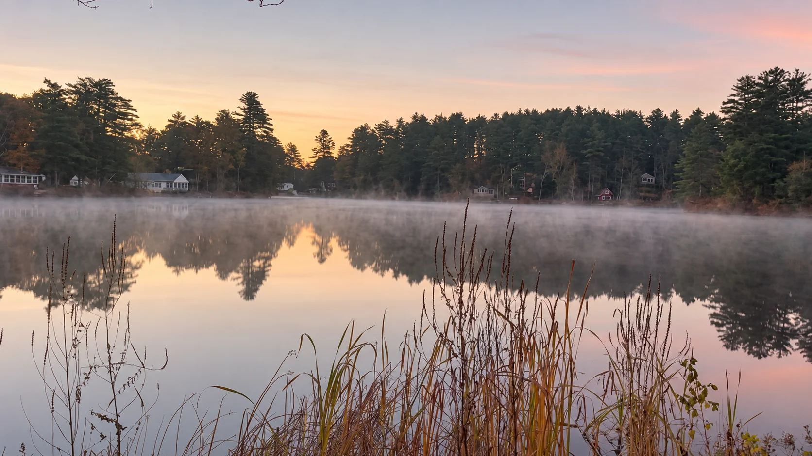
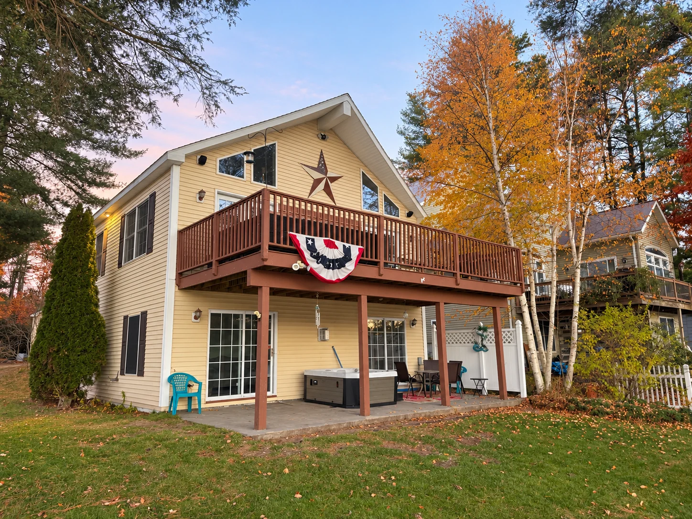
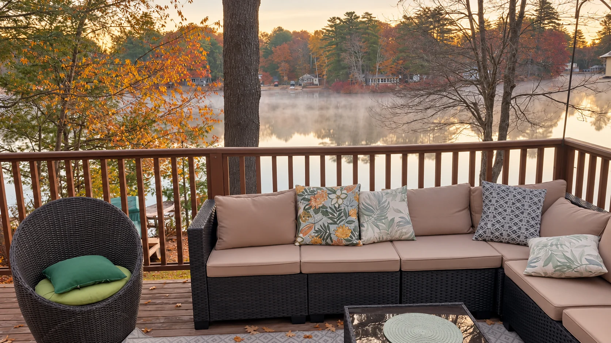

# Autumn morning media — October 28, 2026

Three polished stills and three short silent clips for The Lodge at Kendall Pond.

[Open the visual preview](https://kendallpondlodge.com/media/autumn-2026-10-28.html)

## Photographs

| Photograph | Intended use | Full-size export |
| --- | --- | --- |
| Dawn mist | Opening image or wide atmospheric banner | 1672 × 941 |
| Lodge exterior | Lodge introduction or property gallery | 1448 × 1086 |
| Deck lounge | Outdoor living section | 1672 × 941 |

Each principal image has a high-quality `.jpg`, full-size `.webp`, and `-800.webp` for smaller displays. The three principal stills are AI-assisted retouched derivatives; fine detail can be reconstructed. Original sources remain distinct. Use the manifest to retain provenance.

### Dawn mist

### Lodge exterior

### Deck lounge

## Motion

| Clip | Source selection | Duration |
| --- | --- | --- |
| `kendall-pond-dawn-autumn.mp4` | IMG_0559.mp4, 13.400–15.000 seconds | 1.6 seconds |
| `kendall-pond-deck-lounge-autumn.mp4` | IMG_0579.mp4, 9.500–12.500 seconds | 3 seconds |
| `kendall-pond-outdoor-fireplace-autumn.mp4` | IMG_0580.mp4, 1.500–4.500 seconds | 3 seconds |

Clips are in `public/videos/kpl/2026-10-28/`. Each is native 910 × 512, 30 fps, H.264/yuv420p with faststart, gentle color finishing, and no audio. Timing is unchanged, with no generated frames, crop, or stabilization. These are short cuts, not seamless loops. Matching `-poster.jpg` files in this image folder come from the first encoded frame.

## Source and integrity

`manifest.json` records each public path, dimensions, byte count, SHA-256, source name and hash, relevant frame/trim times, and treatment. No verified capture date is asserted. `SHA256SUMS.txt` can be checked from the repository root with `sha256sum -c public/images/kpl/2026-10-28/SHA256SUMS.txt`.

This collection sits alongside the existing Website Top 50. The preview is a separate, unindexed page; this asset addition does not change the main site photo selections or booking pages.
